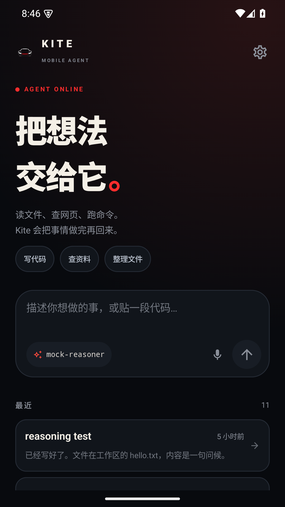
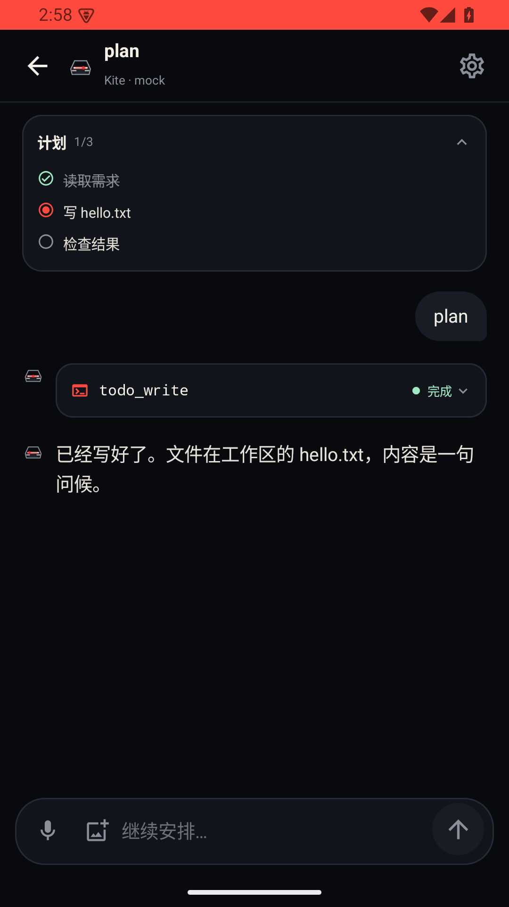
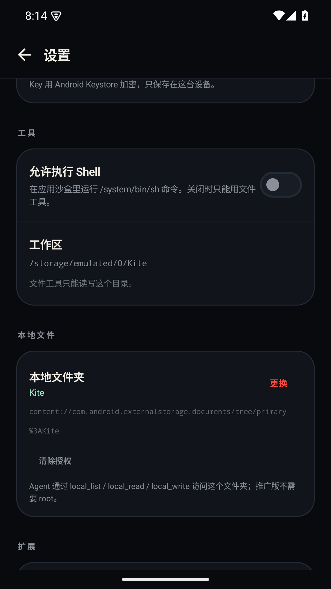
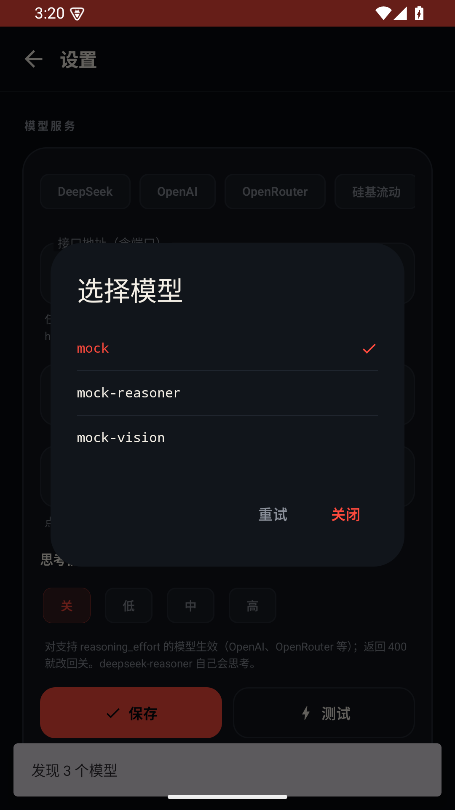
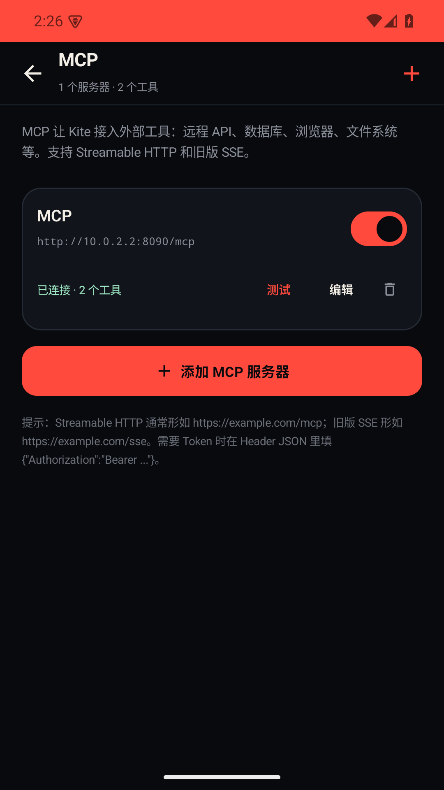
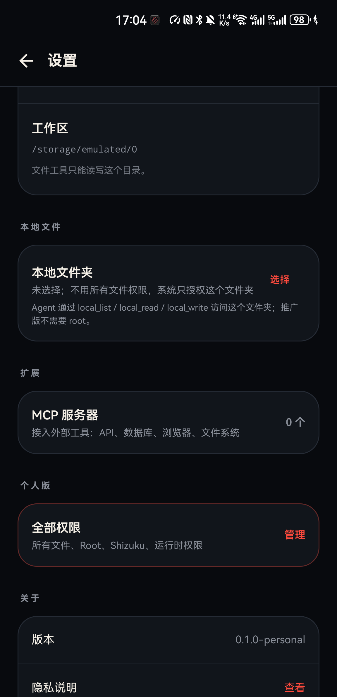
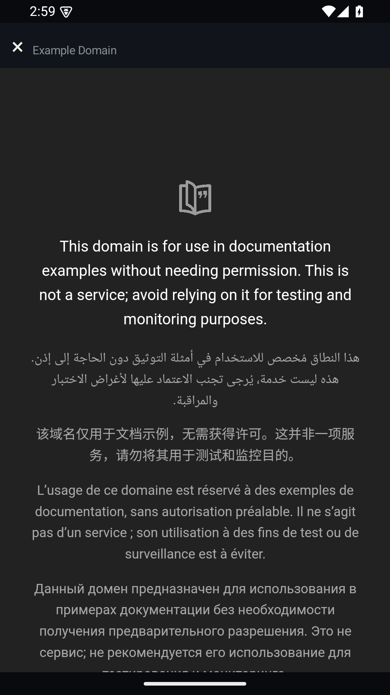
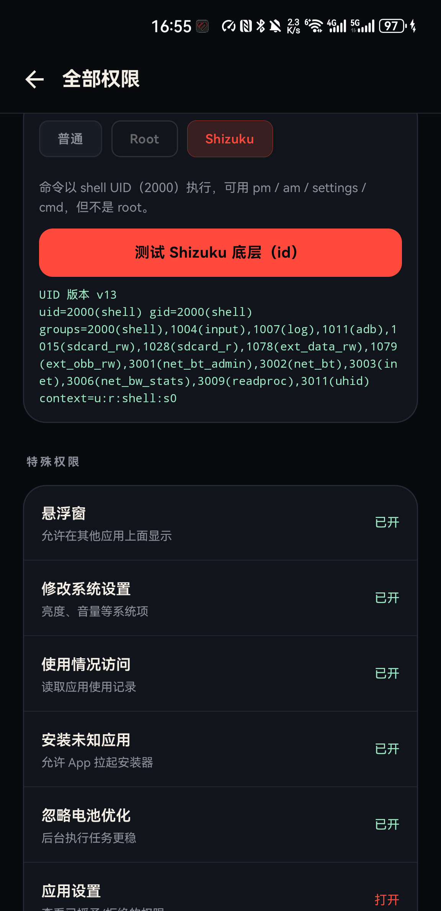

<div align="center">


# Kite

**装在手机里的 AI 智能体 —— 不是遥控器，不是网页壳。**

聊天、工具调用、读写文件、跑命令、操控其他 App，全部在这台手机上完成。

[](https://github.com/marsiss/Kite-Android-Agent/actions/workflows/android.yml)
[](LICENSE)
[-3ddc84.svg)](#环境要求)
[](https://kotlinlang.org)
[](https://developer.android.com/jetpack/compose)

[功能](#功能) · [截图](#截图) · [快速开始](#快速开始) · [两个版本](#两个版本) · [架构](#架构) · [已知限制](#已知限制) · [参与贡献](CONTRIBUTING.md)

</div>

---

## 这是什么

Kite 是一个**原生 Android 应用**，把「对话 + 工具调用」的 Agent 循环整个放进手机：

- 不需要 Termux，不需要电脑，不需要服务器
- 用你自己的 API Key 直连模型服务商（OpenAI 兼容接口都行）
- 工具在你手机上真实执行：读文件、写代码、跑命令、点其他 App 的按钮
- 没有账号、没有遥测、没有云同步 —— 会话和密钥都留在本机

> **Kite 不是**：某个 App 的专用脚本、云端服务、越狱工具。
> 它是你手机上的一个通用助手，能力边界由你给的权限决定。

<div align="center">



</div>

---

## 功能

### 🧠 模型接入

- **任意 OpenAI 兼容接口**，支持自定义 Base URL 与端口
- 预设：DeepSeek · OpenAI · OpenRouter · 硅基流动 · 智谱 · Ollama
- 点「获取模型」自动拉取 `/models` 列表
- 流式输出（SSE），`reasoning_content` 思考过程可折叠查看
- 思考模式：关 / 低 / 中 / 高（`reasoning_effort`）
- 图片附件：相册选图，压缩后按多模态格式发送

### 🔧 工具调用

模型能真实操作你的设备。完整工具表见 [下方](#工具清单)。

| 类别 | 能力 |
|---|---|
| **文件** | 列目录、按行读、写、精确替换、正则搜索、移动、复制、删除、建目录、文件信息 |
| **文档解析** | PDF、DOCX、XLSX、PPTX、纯文本 → 提取为文本喂给模型 |
| **网络** | 抓网页正文、搜索、任意 HTTP 请求 |
| **Shell** | `/system/bin/sh`，三档权限：沙盒 / Root / Shizuku |
| **手机** | 设备信息、应用列表、启动 App、开链接、剪贴板读写、分享、通知、朗读、定位、通讯录 |
| **系统界面** | 写短信、拨号、建日历事件、设闹钟（都需你确认） |
| **浏览器** | 可见 WebView，打开 / 读 / 点击 / 输入 / 后退 / 关闭，支持下载 |
| **跨 App 自动化** | 无障碍读屏、点击、输入、滚动、返回、回桌面（仅个人版） |

### 🤖 Agent 能力

- **多轮工具循环** —— 工具结果自动回注，模型继续推理
- **任务计划** `todo_write` —— 聊天页顶部实时进度面板
- **子智能体** `spawn_subagent` —— 独立上下文跑子任务，只回传结论
- **上下文压缩** —— 估算 token，超过约 24k 自动压缩（保留最近 30 条）
- **工具审批门** —— 危险操作挂起弹窗等你确认，120 秒超时按拒绝处理
- **一级撤销** —— 写/删/移动前自动备份，`undo_last` 一键还原

### 🧩 扩展机制

<table>
<tr><td width="33%" valign="top">

**MCP**

接远程 MCP 服务器。Streamable HTTP 与旧版 SSE 都支持，自动 `initialize` + `tools/list`，工具以 `mcp__<server>__<tool>` 注入模型。支持 resources / prompts。凭证 Keystore 加密。

</td><td width="33%" valign="top">

**技能 Skills**

`.kite/skills/<name>/SKILL.md`（带 frontmatter）。技能清单动态注入系统提示词，模型可按需读取。配套 `list_skills` / `read_skill` / `write_skill`。

</td><td width="33%" valign="top">

**定时任务**

WorkManager 后台执行 Agent 回合。支持重复间隔，完成后发通知。适合「每天早上帮我总结一下日程」这类需求。

</td></tr>
</table>

### 🎨 界面

- 原创视觉：黑曜石底 + 红色扫描灯（KITT 风格致敬），风筝菱形标记
- 首页 / 对话 / 设置 / 权限 / MCP / 技能 / 定时任务 / 开源许可
- 轻量 Markdown 渲染 + 代码块
- 工具调用卡片：参数、输出、状态可展开
- 系统分享入口：其他 App 分享文本可直接开新会话
- 长按麦克风连续语音输入

### 🔒 隐私

- API Key 与 MCP 凭证用 **Android Keystore AES-GCM** 加密，密钥不出 TEE
- **无**统计 SDK、广告、账号体系、云同步、崩溃上报
- 会话与工作区在应用私有目录，卸载即删除
- 完整说明见 [PRIVACY.md](PRIVACY.md) 与 [SECURITY.md](SECURITY.md)

---

## 截图

| 对话与工具调用 | 模型配置 | MCP 服务器 |
|---|---|---|
|  |  |  |

| 工作区 | 浏览器自动化 | Shizuku |
|---|---|---|
|  |  |  |

---

## 快速开始

### 直接用

从 [Releases](https://github.com/marsiss/Kite-Android-Agent/releases) 下载 APK 侧载安装。

> ⚠️ **`personal` 版本声明了短信、通话记录、通讯录、所有文件访问等敏感权限**，仅供自己侧载使用，**不要上传到 Google Play**。

装好后：

1. 打开 **设置 → 模型服务**，选服务商或填自定义 Base URL
2. 填入你的 API Key（加密存在本机）
3. 点「获取模型」，选一个模型
4. 回首页开始对话

### 自己构建

**环境要求**

| 项 | 版本 |
|---|---|
| JDK | 17 |
| Android SDK Platform | 35 |
| Android Build Tools | 35 |
| Gradle | 8.13（用仓库里的 `gradlew`） |
| 最低运行系统 | Android 8.0（API 26） |

```bash
git clone https://github.com/marsiss/Kite-Android-Agent.git
cd kite
echo "sdk.dir=/path/to/android-sdk" > local.properties

./gradlew :app:assembleDebug          # 调试版
./gradlew :app:assembleRelease        # Play 版（未签名）
./gradlew :app:assemblePersonal       # 个人版（未签名）
```

Windows：

```powershell
$env:JAVA_HOME='C:\path\to\jdk-17'
.\gradlew.bat :app:assemblePersonal
```

产物在 `app/build/outputs/apk/<variant>/`。

**签名（可选）**

在根目录建 `keystore.properties`（**已被 .gitignore 忽略，不要提交**）：

```properties
storeFile=your-release.keystore
storePassword=******
keyAlias=your-alias
keyPassword=******
```

没有这个文件时构建照常进行，只是产物未签名。

---

## 两个版本

同一个包名 `app.kite.agent`，可互相覆盖安装，但权限和能力差别很大。

| | **Play 版**（`release`） | **个人版**（`personal`） |
|---|---|---|
| 用途 | Google Play 上架 | 自己用、侧载 |
| 权限 | 6 个基础权限 | 54 个声明 + 运行时申请 |
| 工作区 | 应用沙盒 / SAF 授权目录 | 可切到 `/storage/emulated/0` |
| Shell | 普通沙盒 | 普通 / Root / Shizuku |
| 无障碍跨 App | ❌ | ✅ |
| 所有文件访问 | ❌ | ✅ |
| 上架 | ✅ | ❌ **不要上传 Play** |

```bash
./gradlew :app:assemblePersonal
# → app/build/outputs/apk/personal/app-personal.apk
```

Play 版的 6 个权限：

```
INTERNET
ACCESS_NETWORK_STATE
POST_NOTIFICATIONS
FOREGROUND_SERVICE
FOREGROUND_SERVICE_DATA_SYNC
com.android.alarm.permission.SET_ALARM
```

上架资料见 [PLAY.md](PLAY.md)。

---

## 工具清单

| 工具 | 作用 | 默认 | 需确认 |
|---|---|:---:|:---:|
| `list_dir` | 列出工作区目录 | ✅ | |
| `read_file` | 按行读取文本 | ✅ | |
| `write_file` | 覆盖写文件 | ✅ | ✔ |
| `replace_in_file` | 精确字符串替换 | ✅ | ✔ |
| `grep` | 正则搜索文件内容 | ✅ | |
| `move_path` / `copy_path` | 移动 / 复制 | ✅ | ✔ |
| `delete_path` | 删除 | ✅ | ✔ |
| `make_dir` / `file_info` | 建目录 / 文件信息 | ✅ | |
| `undo_last` | 撤销上一次破坏性写操作 | ✅ | |
| `web_fetch` | 抓取网页正文 | ✅ | |
| `web_search` | 网页搜索 | ✅ | |
| `http_request` | 任意 HTTP 请求 | ✅ | |
| `run_shell` | `/system/bin/sh` | ❌ | ✔ |
| `spawn_subagent` | 派生子智能体 | ✅ | |
| `todo_write` | 写入任务计划 | ✅ | |
| `list_skills` / `read_skill` | 查看技能 | ✅ | |
| `write_skill` | 新建 / 修改技能 | ✅ | ✔ |
| `schedule_task` | 创建定时任务 | ✅ | ✔ |
| `browser_*` | 浏览器自动化 | ✅ | |
| `screen_*` | 无障碍跨 App 操作（个人版） | 个人版 | ✔ |
| `device_info` / `list_apps` / `open_app` / `open_url` | 设备与应用 | ✅ | |
| `clipboard_read` / `clipboard_write` / `share_text` | 剪贴板与分享 | ✅ | |
| `notify` / `speak` | 通知与朗读 | ✅ | |
| `get_location` / `read_contacts` | 定位与通讯录 | ✅ | |
| `compose_sms` / `dial_number` / `create_calendar_event` / `set_alarm` | 系统界面操作 | ✅ | ✔ |
| `mcp__<server>__<tool>` | 来自 MCP 服务器的工具 | 按配置 | |

> `run_shell` 默认关闭，需要在 **设置 → 工具** 里手动打开。
> 开启后由模型生成命令，**请只让可信的模型使用**。

---

## 架构

```
app/src/main/java/app/kite/agent/
├── MainActivity.kt          入口、edge-to-edge、分享 Intent
├── AppViewModel.kt          会话状态、事件归并、持久化
├── AgentService.kt          前台服务保活
├── SystemAccess.kt          系统权限申请
│
├── agent/                   ← Agent 核心
│   ├── AgentEngine.kt       多轮工具调用循环、上下文压缩
│   ├── LlmClient.kt         OpenAI 兼容 SSE 客户端
│   ├── Tools.kt             工具定义与执行器
│   ├── Prompts.kt           系统提示词（动态注入技能清单）
│   ├── ApprovalGate.kt      危险工具审批门
│   ├── ModelCatalog.kt      模型目录与预设
│   └── ScheduledWorker.kt   WorkManager 定时任务
│
├── data/                    ← 数据层
│   ├── Models.kt            Message / Session / ProviderConfig
│   ├── Settings.kt          SharedPreferences + Keystore
│   ├── Crypto.kt            AES-GCM 加解密
│   ├── SessionStore.kt      JSON 会话持久化
│   ├── DocumentParser.kt    PDF / OOXML / 文本解析
│   ├── Skills.kt            技能加载与存储
│   ├── UndoStore.kt         一级撤销备份
│   ├── McpStore.kt          MCP 服务器配置
│   └── OpenSource.kt        开源致谢数据源
│
├── mcp/                     ← MCP 客户端
│   ├── McpClient.kt         Streamable HTTP + 旧版 SSE
│   └── McpManager.kt        连接管理与工具注入
│
├── access/                  ← 无障碍
│   └── KiteAccessibilityService.kt
│
├── browser/                 ← 浏览器自动化
│   ├── BrowserActivity.kt
│   └── BrowserController.kt
│
└── ui/                      ← Compose 界面
    ├── KiteRoot.kt          路由
    ├── HomeScreen.kt        首页 / 最近任务
    ├── ChatScreen.kt        对话 / 工具卡片 / 计划面板
    ├── SettingsScreen.kt    设置
    ├── McpScreen.kt         MCP 服务器管理
    ├── SkillsScreen.kt      技能管理
    ├── ScheduledScreen.kt   定时任务
    ├── LicensesScreen.kt    开源许可
    ├── AccessScreen.kt      权限中心
    ├── Markdown.kt          轻量 Markdown 渲染
    └── theme/Theme.kt       设计系统
```

分层原则：`ui` 只调用 `AppViewModel`；`agent` 不依赖 `ui`；`data` 不依赖上层。
详细说明见 [docs/ARCHITECTURE.md](docs/ARCHITECTURE.md)。

---

## 已知限制

诚实列出来，免得你踩坑：

| 限制 | 说明 |
|---|---|
| **Root 基本拿不到** | 华为 / 荣耀等锁定 Bootloader 的机型无法解锁，见下方专门说明。Shizuku 上限是 UID 2000（ADB shell），不是 root。 |
| **后台虚拟屏幕不可用** | 需要 `ADD_TRUSTED_DISPLAY`，非系统应用拿不到，除非 root。 |
| **无障碍会掉** | App 更新后无障碍服务会被系统关闭，需要去 **设置 → 全部权限** 重新开启。 |
| **Shizuku 重启即失效** | 手机重启后需要重新启动 Shizuku 服务（用 ADB 或无线调试）。厂商省电策略可能杀掉它。 |
| **音视频转写没有** | 目前只能处理文本、图片、PDF、Office 文档。 |
| **Office 只读文本** | 能提取 DOCX / XLSX / PPTX 的文字，但**不做保格式编辑**。 |
| **MCP 无 OAuth** | 目前只支持 Header Token 鉴权。 |
| **只有中文界面** | 多语言还没做。 |

### 关于 Root（以华为 Kirin 9000 为例）

如果你手上是 **华为 Mate 40 系列（NOH / NOP-AN00，Kirin 9000）** 这类锁定 Bootloader 的机器，可以直接放弃了：

- 华为 2018 年起关闭官方解锁码申请通道
- [Kirin-Tool](https://github.com/kethily-daniel/Kirin-Tool) 支持到 **Kirin 990 5G**，**不含 Kirin 9000**
- TASZK 安全实验室披露的 Kirin 990 BootROM 漏洞，华为在**首批 Kirin 9000 出厂前**就修掉了（[原文](https://labs.taszk.io/articles/post/huawei_kirin990_bootrom_patch/)）
- HCU 等测试点解锁要求设备运行 **Android 9**，且不覆盖 Kirin 9000
- 9008 / 下载模式只能救砖、刷分区，**改不了 BL 锁状态**

**结论：没有公开可复现的解锁链。** Kite 在锁 BL 设备上的实际上限就是 Shizuku（UID 2000），
能跑 `pm` / `am` / `settings` / `cmd`，但不能读写其他应用私有目录、不能改系统分区。

Kite 不会内置任何绕过手段，也不会帮你刷来路不明的内核 —— 刷坏就是真报废。

---

## Roadmap

**近期**

- [ ] 语音唤醒词与连续语音对话
- [ ] MCP OAuth 自动授权
- [ ] 浏览器截图、多标签、下载管理
- [ ] 代码 diff 预览与语法高亮
- [ ] 多工作区切换

**中期**

- [ ] 迁移到官方 [MCP Kotlin SDK](https://github.com/modelcontextprotocol/kotlin-sdk)
- [ ] 英文界面与多语言
- [ ] 音视频转写（本地 Whisper / 云端 ASR）
- [ ] 技能市场与导入导出

**长期**

- [ ] 多端：微信小程序 / 鸿蒙元服务轻客户端（见 [docs/PLATFORM-PLAN.md](docs/PLATFORM-PLAN.md)）
- [ ] 可选的自建 Gateway（Key 放服务端，多端统一配额）

完整路线与取舍见 [docs/ROADMAP.md](docs/ROADMAP.md)。

---

## 参与贡献

欢迎 PR。开工前请读 [CONTRIBUTING.md](CONTRIBUTING.md)，里面写了：

- 环境与构建
- 代码约定（注释中文、标识符英文、不做过度抽象）
- **怎么加新工具**（必须登记到 `Prompts.kt`，危险工具要接审批门）
- **怎么加新依赖**（项目刻意精简，LGPL/GPL 不要引）

安全问题请走私密渠道，见 [SECURITY.md](SECURITY.md)。

---

## 开源致谢

Kite 是独立实现，**没有复制** DSH Desktop、OpenCode、Mika 或 Operit 的源代码。

**运行时依赖**

Kotlin · AndroidX / Jetpack · WorkManager · Jetpack Compose · Material 3 · kotlinx.coroutines · OkHttp · Gson · Jsoup · PDFBox-Android · Shizuku API

**参考项目（仅对照功能形态，未复制代码）**

- [Mika](https://github.com/wangzan101/Mika) — Apache-2.0，Android Agent 形态与技能设计参考
- [Operit](https://github.com/AAswordman/Operit) — LGPL-3.0，功能清单对照。**因 LGPL 未引入任何代码**
- [OpenCode](https://github.com/anomalyco/opencode) — MIT，Agent 会话与工具行为参考

**评估中**

- [Koog](https://github.com/JetBrains/koog) — Apache-2.0
- [MCP Kotlin SDK](https://github.com/modelcontextprotocol/kotlin-sdk) — Apache-2.0

完整的版本号、许可证与用途见 [THIRD-PARTY.md](THIRD-PARTY.md)。
应用内同样可查：**设置 → 关于 → 开源许可**。

> **商标**：KITT / Knight Rider 商标归其各自权利人所有。Kite 的界面是原创设计，只做风格致敬，
> **不包含** KITT 的剧照、车标或任何官方素材。Kite 与上述权利人无隶属、赞助或背书关系。

---

## License

[Apache License 2.0](LICENSE) © 2026 Kite contributors

分发时请附带 `LICENSE` 并保留 [NOTICE](NOTICE) 中的归属声明。
